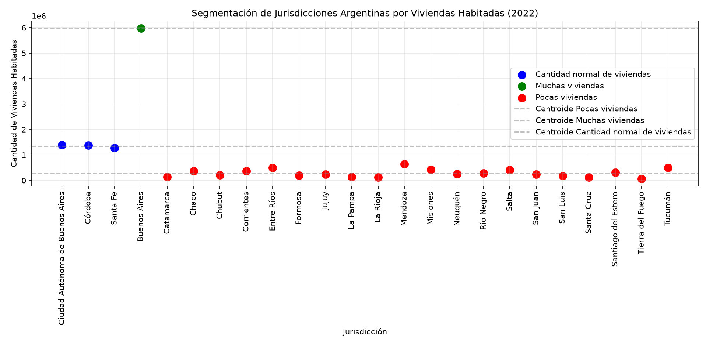

# Segmentación de Jurisdicciones Argentinas con K-Means

## 👥 Datos del trabajo

- **Integrantes:**
  - Yapura Valentina
  - Mansilla Angeles 
  - Bejerano Thomas
  - Lugo Facundo
- **Materia:** Procesamiento de Aprendizaje Automático
- **Carrera:** Tecnicatura Superior en Ciencia de Datos e Inteligencia Artificial
- **Profesora:** Yanina Scudero

---

## 📌 Descripción

Programa en Python que usa el algoritmo **K-Means** para agrupar las jurisdicciones de Argentina en **tres segmentos** según su cantidad de **viviendas particulares habitadas**:

- Muchas viviendas
- Cantidad normal de viviendas
- Pocas viviendas

**Datos:** INDEC, viviendas particulares habitadas por jurisdicción, año 2022 (24 jurisdicciones).

## 🛠️ Tecnologías

- Python 3
- pandas
- scikit-learn (`KMeans`)
- matplotlib

## 📂 Archivos

- `segmentacion_viviendas.py`: script con la solución.
- `grafico_segmentacion.png`: gráfico de dispersión generado.
- `README.md`: este archivo.

## 🧠 Cómo funciona

1. **Carga de datos:** se arma un `DataFrame` con las columnas `Jurisdiccion` y `Viviendas_Habitadas`.
2. **K-Means:** se aplica `KMeans(n_clusters=3, random_state=42)` sobre la cantidad de viviendas.
3. **Etiquetas:** se ordenan los centroides de menor a mayor y se asigna *Pocas*, *Cantidad normal* y *Muchas viviendas*. Así no importa qué número de cluster le haya tocado a cada grupo.
4. **Resultados:** se imprime a qué segmento pertenece cada jurisdicción.
5. **Gráfico:** dispersión de las jurisdicciones coloreadas por segmento, con líneas punteadas en los centroides.

## 🚀 Cómo ejecutar

```bash
pip install pandas scikit-learn matplotlib
python segmentacion_viviendas.py
```

## 📊 Resultados

| Segmento | Jurisdicciones | Centroide (viviendas) |
| --- | --- | ---: |
| **Muchas viviendas** | Buenos Aires | 5.970.702 |
| **Cantidad normal de viviendas** | Ciudad Autónoma de Buenos Aires, Córdoba, Santa Fe | ≈ 1.347.652 |
| **Pocas viviendas** | Las otras 20 jurisdicciones (de Mendoza, 639.467, a Tierra del Fuego, 65.535) | ≈ 284.268 |



## 🔎 Conclusiones

- **Buenos Aires** forma un grupo propio: tiene más de cuatro veces las viviendas de la jurisdicción que le sigue (CABA).
- **CABA, Córdoba y Santa Fe** quedan juntas en el grupo intermedio, con valores muy parecidos (entre 1,27 y 1,39 millones).
- **El resto del país** queda en "Pocas viviendas".
- Como Buenos Aires es un valor muy atípico, K-Means le dedica un cluster entero y 20 de las 24 jurisdicciones quedan en un solo grupo.
